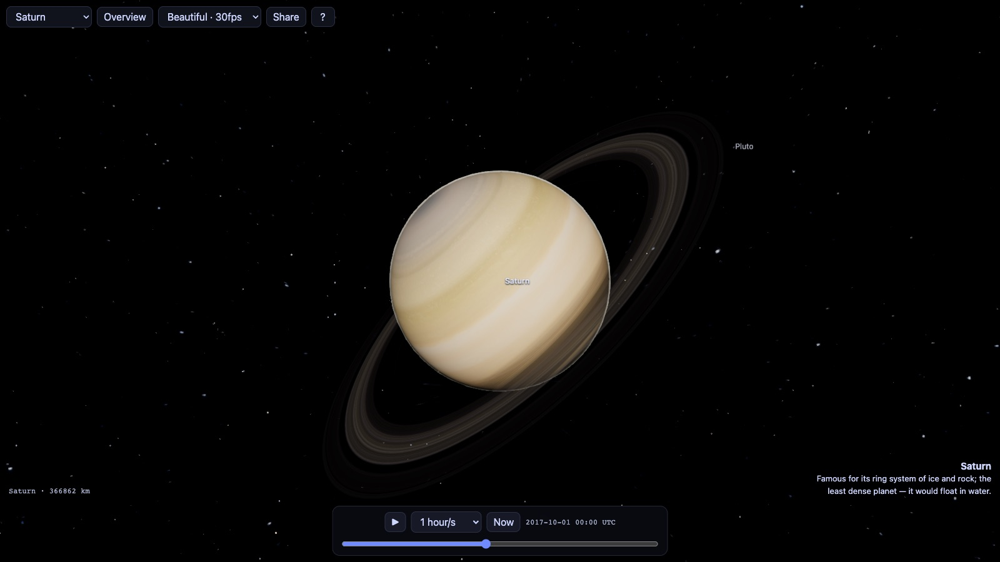

# Orrery

**▶ Try it in your browser: https://firstprateek.github.io/orrery/**

A real-time 3D solar system you can fly through. Every planet, Pluto and 13
major moons sit at their true positions for any date within ±100 years, under
one shared sky of 9,000 real stars. Zoom from the whole system down to a
single moon, scrub time, or switch to an overview where the whole system fits
on screen.

[](https://github.com/firstprateek/orrery/actions/workflows/ci.yml)

[](https://firstprateek.github.io/orrery/?obj=saturn&date=2017-10-01T00:00:00.000Z)

## What you can do

A fresh visit opens on the whole system, then glides in to Earth. From there:

- **Travel between planets.** Click or tap a planet or its label, pick one from
  the menu at the top left, or step through them with the ‹ › arrows beside it
  (`[` / `]` on the keyboard). The camera glides there and frames it.
- **Look around and zoom.** Every body is explorable at true scale, from Jupiter's
  bands to Phobos. The zoom panel at the bottom right shows how far you've
  zoomed from the default view, with − / + buttons and *Reset*.
- **See the whole system.** *Overview* compresses distances and enlarges the
  bodies so everything out to Neptune fits on one screen. Zooming far out
  switches to it automatically; *True scale* switches back.
- **Move through time.** The time bar plays, pauses, and speeds up from
  real time to a year per second. The slider scrubs ±100 years and *Now*
  returns to the present.
- **Share a view.** *Share* copies a link to the body, exact moment and scale
  mode you're looking at, for example
  [Saturn on 1 October 2017](https://firstprateek.github.io/orrery/?obj=saturn&date=2017-10-01T00:00:00.000Z),
  when its rings were near their widest (drag to tilt the view and see them).
- **Trade looks for speed.** The quality menu picks *Low*, *Medium* or *High*:
  higher tiers add Sun bloom and render at a higher resolution. First visits
  start on Medium where the GPU supports it and drop to Low if the frame rate
  struggles; a choice you make is remembered. On phones, quality and *Share*
  sit under the *⋯* button.

### Controls

| | Mouse / trackpad | Touch | Keyboard |
|---|---|---|---|
| Look around | Drag | Drag with one finger | |
| Zoom | Scroll, trackpad pinch, or − / + | Pinch, or − / + | `⌘ +` / `⌘ −` (Ctrl on Windows/Linux, or plain `+` / `−`); `⌘ 0` to reset |
| Fly to a body | Click it or its label, the menu, or ‹ › | Tap it or its label, or the menu | `[` / `]` previous / next body |
| Help | `?` button | `?` button | `?` |

## How it works

- **Positions.** [astronomy-engine](https://github.com/cosinekitty/astronomy)
  gives the Sun, planets, Moon and Galilean moons to about 1 arcminute. The other
  moons and the asteroid belt use a small two-body Kepler propagator. This is
  visualization-grade, not spacecraft-grade.
- **Orientation.** Spin axes and prime meridians follow the IAU rotation
  elements (pole right ascension/declination and W), rotated into the ecliptic
  frame, so seasons, day and night and ring tilts match the date: at 12:00 UTC
  the Sun stands within a few degrees of the Greenwich meridian, and Saturn’s
  rings open to the Sun in 2017, go edge-on in 2025 and open the other way by
  the 2030s. Earth follows astronomy-engine's precession and sidereal time; the
  Sun, the other planets, the Moon and Pluto use astronomy-engine's IAU
  rotation model (exact rates, pole drift, the Moon's libration terms); the
  other moons use their IAU pole and W at J2000, and those on approximate
  Kepler orbits turn longitude 0 to their planet. Each map's own longitude
  convention is honoured (several moon and Pluto maps are centred on 180°), so
  the right hemisphere faces the planet or the Sun; subsolar longitudes match
  JPL Horizons to a fraction of a degree in the tests.
- **Scale.** The solar system spans nearly nine orders of magnitude, from
  12 km-wide Deimos to Pluto 35 AU from the Sun. Positions stay in double precision and are made
  relative to the focused body before they reach the GPU (a "floating origin"),
  and a logarithmic depth buffer keeps near and far objects sorted, so you can
  zoom from the whole system to a moon without jitter. The overview is a
  separate power-law mapping that the app blends to and from.
- **One shared sky.** Stellar parallax across the whole solar system is under
  a pixel, so there's one J2000 sky for every viewpoint: 9,096 Yale Bright Star
  Catalog stars, sized by magnitude and coloured by temperature, over a
  Milky Way map rotated from galactic coordinates into the same frame, so the
  bulge sits in Sagittarius and the painted stars line up. What changes between viewpoints is the Sun's direction and size
  and where the other bodies are.
- **Rendering.** [three.js](https://threejs.org) on WebGL2: HDR bloom on the
  Sun, atmosphere rims with a twilight band, Earth's city lights and moving
  clouds, Saturn's rings and planet casting shadows on each other, and an
  instanced asteroid belt. Moon textures load only when you visit their planet.
- **Static site.** TypeScript and [Vite](https://vite.dev), no backend. GitHub
  Actions runs type checks, the build and the tests on every PR and deploys
  `main` to GitHub Pages.

The original design plan, with the coordinate-system and accuracy contracts, is
in [docs/PLAN.md](docs/PLAN.md).

## Run it locally

Needs Node 22.12+ or 24+.

```bash
npm install
npm run dev        # dev server at http://localhost:5173
```

```bash
npm test           # unit tests (Vitest): orbits, ephemeris against almanac values, picking, URL state…
npm run typecheck
npm run build      # production build to dist/ (served under /orrery/)
npm run preview    # serve the production build
```

Add `?debug` to the URL for frame time and GPU info. Textures and the star
catalog are committed; `scripts/` holds the scripts that fetched them.

## Credits

Planet (except Pluto), Sun, Moon, ring and Milky Way textures are by
[Solar System Scope](https://www.solarsystemscope.com/textures/) (CC BY 4.0).
Moon and Pluto maps are by Björn Jónsson, NASA/JPL/USGS, Cassini/SSI and
NASA/JHUAPL/SwRI (New Horizons), and star data is from the Yale Bright Star
Catalog. Full attributions are in [CREDITS.md](CREDITS.md).

Code is MIT licensed ([LICENSE](LICENSE)).
